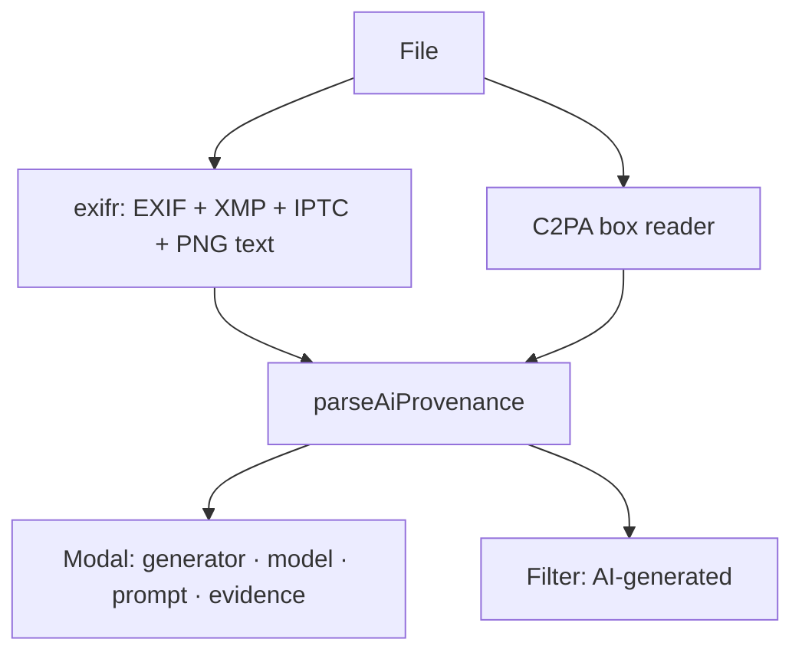

# Plan: show proof that an image is AI-generated

Requested 2026-11-07, for later. When a photo was AI-generated, the photo modal should show what proves
it, plus the **prompt** and **model** whenever the file carries them.

## Where the evidence lives

| Source | Where it is in the file | What it holds |
|--------|-------------------------|---------------|
| Automatic1111 / Forge / **Civitai** downloads | PNG `tEXt` chunk `parameters` | prompt, negative prompt, steps, sampler, seed, `Model:`, `Model hash:`, Civitai resource hashes |
| ComfyUI (also many **tensor.art** exports) | PNG `tEXt` chunks `prompt` and `workflow` (JSON) | full node graph: checkpoint name, positive/negative text nodes |
| NovelAI | PNG `tEXt` `Comment` (JSON) + `Software` | prompt, model |
| **Gemini / Imagen**, ChatGPT/DALL·E, Adobe Firefly, Microsoft Designer | C2PA manifest (JUMBF in a JPEG APP11 / PNG `caBX` box) | signed claim: generator, actions ("created by AI"), sometimes the model |
| Google (all generators) | **SynthID** invisible watermark | can't be read on-device; only Google's detector can |
| **Replicate**, Midjourney, others | usually EXIF/XMP `Software`, `ImageDescription`, `UserComment`, XMP `dc:description`; IPTC `DigitalSourceType = trainedAlgorithmicMedia` | varies by tool; the IPTC field is the standard "this is AI" flag |
| WebP / JPEG from A1111 | EXIF `UserComment` | same `parameters` text as the PNG chunk |

## Approach

1. Extend the existing EXIF read (`@modernized/exifr`, already a dependency, lazily per file) to also
   return XMP, IPTC and the PNG text chunks. exifr already reads PNG `tEXt`/`iTXt`.
2. A small pure `parseAiProvenance(meta) → { generator, model?, prompt?, negative?, evidence[] }`, with
   one branch per row of the table above, covered by a fixture test per tool.
3. C2PA: parse the manifest's claim generator and its `c2pa.actions` without verifying signatures first
   (show "unverified C2PA"); add verification with `c2pa-js` only if wanted. It is a large WASM.
4. The modal gets an "AI-generated" section showing the evidence chain: which field said so, the prompt
   (collapsed if long) and the model. The folder filter gets an "AI-generated: yes/no/unknown" option.

Open question: should prompts be embedded as text into the search space, so "find images whose prompt
mentions X" works?
