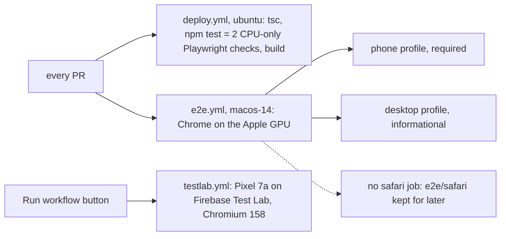

# Handoff: EmbeddingGemma 2 + end-to-end test overhaul (2026-10-23)

Read this with `AGENT.md`. It covers what landed, how testing works now, and what is left.

## Merged

| PR  | What                                                                                                                                                                                                                                                                                                                                                                                                                                           |
|-----|------------------------------------------------------------------------------------------------------------------------------------------------------------------------------------------------------------------------------------------------------------------------------------------------------------------------------------------------------------------------------------------------------------------------------------------------|
| #31 | EmbeddingGemma 2 (`onnx-community/embeddinggemma-2-ONNX`, q4, 768-d, text search built in) is the default wherever a **real WebGPU adapter** exists. It has a phone profile (70 image tokens, 4 video frames, fixed sequence length 296). It also fixes the SmolVLM2 path, which never produced vectors. Finally, it adds a modal that stays up until dismissed and explains `chrome://flags/#enable-unsafe-webgpu` when Chrome hides the GPU. |
| #35 | Settings lists ranked by the benchmark (`src/benchmarkRanks.ts`, generated by `bench/rank.mjs`). The recommendation for this device comes first, and models the device can't run are struck through. UMAP is the new default projection.                                                                                                                                                                                                       |
| #33 | Tests are end to end only. Unit tests and vitest are gone. See the next section.                                                                                                                                                                                                                                                                                                                                                               |

## How testing works

- `npm test`: `e2e/cpu.spec.ts` checks viewer mode and the no-adapter fallback plus the help modal. It needs Google Chrome installed. The pre-commit hook runs it. With no Chrome, set `SWIFTSHADER=<chromium binary>`.
- `npm run test:gpu`: `e2e/embeddinggemma2.spec.ts` runs real files from `e2e/fixtures/` (jpg, png, webp, mp4, webm). Four text queries must each rank the right file first. On macos-14 the model loads in about 14 s and embedding takes about 11 s.
- **Test Lab** (`testlab.yml`) is on demand only. The harness is in `android-device-test/` and the page is `device-test.html` (`src/deviceTest.ts`). It signs in with Workload Identity Federation (through a service account, no key file), and setup steps are at the top of the file.
  - Still to do: set the repository variables `GCP_WIF_PROVIDER`, `GCP_SA_EMAIL`, `GCP_PROJECT_ID` and `GCP_RESULTS_BUCKET`. The bucket can be `personal-398106-eg2-testlab-c50fbb6f`.
  - The Pixel 7a passed in 825 s: about 504 s to load (mostly the Hugging Face download), about 34 s per photo, 131 s for a 4-frame video, and about 13 s per search.

## Things that look wrong but aren't

- **Pixel 10:** left out on purpose. Chrome blocklists its PowerVR driver for WebGPU (`gpu/config/webgpu_blocklist_impl.cc`, pattern `"*:*:PowerVR*25.1*"`), so the adapter is `null`. With the flag forced on it runs on real hardware (`img-tec d-series`), but at about 330 s per photo, and the GPU watchdog reset it (`GUILTY_OVERRUNING`). Real users there get SmolVLM2 plus the help modal.
- **Safari:** Safari 26.6 on GitHub's `macos-26` runner returns no WebGPU adapter, so there is no Safari job (actionlint rejects `if: false`). Add one back to e2e.yml when that changes; the comment at its end says how. The test is `e2e/safari/` (node:test + safaridriver).
- **Linux/Windows hosted runners:** SwiftShader only, no real GPU. Don't run the GPU suite there.
- **Test Lab stock Chrome is too old:** Chrome 103 on the Pixel 7a has no WebGPU, so the workflow sideloads Chromium 158 (snapshot rev 1725074).
- **npm 10 crashes on install** (`Cannot read properties of null (reading 'edgesOut')`). Use `npx -y npm@11 install …`. Add `--ignore-scripts` if the onnxruntime-node postinstall can't download.
- **Model downloads from Hugging Face can stall** for many minutes with no progress events. That accounts for two Test Lab runs of about 30 min each.

## Open items, most useful first

1. **Download stall watchdog:** if no progress arrives for about 60 s, retry, or show the error with a Retry button. transformers.js fetches have no timeout. Real users hit this too.
2. **SmolVLM2 download is about 190 MB, not 55.** transformers.js 4.3 ignores `model_file_name` and also fetches embed_tokens and the decoder. Loading `onnx/vision_encoder_q4f16.onnx` alone through onnxruntime-web would fix that. There's a `shortcut:` comment in `src/vlmWorker.ts`.
3. **Done:** the benchmark put nomic ahead of SmolVLM2 (Holidays 0.911 vs 0.895, COCO 0.560 vs 0.505, and it has text search), so `NO_WEBGPU_MODEL` is now `nomic`.
4. **Pick the phone/desktop profile from the adapter, not the user agent.** Use `maxStorageBufferBindingSize`: Pixel 7a reports 256 MB, the macOS runner 2 GB.
5. **Gemini Nano runs on hosted runners.** On ubuntu-latest and windows-latest (4 vCPU, 16 GB RAM), Chrome 155 and 156 reported `downloadable`. The model downloaded in about 90 s, then described a test image in about 9 s ("A white circle is centered on a red background."). It needed `--enable-features=PromptAPIForGeminiNano,PromptAPIForGeminiNanoMultimodalInput,OptimizationGuideOnDeviceModel:BypassPerfRequirement/true`, plus Playwright's `--disable-component-update` and `--disable-background-networking` removed. The on-demand test is `.github/workflows/chrome-ai.yml` (`e2e/chrome-ai.spec.ts`, its own persistent Chrome profile, because the Prompt API is off in Playwright's default incognito-like contexts). **App bug:** when Nano is `downloadable`, `loadModelOnce` only polls availability and never calls `LanguageModel.create()`, which needs a user gesture, so a fresh user times out after 120 s. Start the download from the Load Model click.
6. **#34 (benchmark):** still running (desktop profile, Sapiens2, COCO). Re-run `bench/rank.mjs` when it's done to refresh `src/benchmarkRanks.ts`.
7. **#32:** marked not for merge, and #33 carries its harness. Close it.
