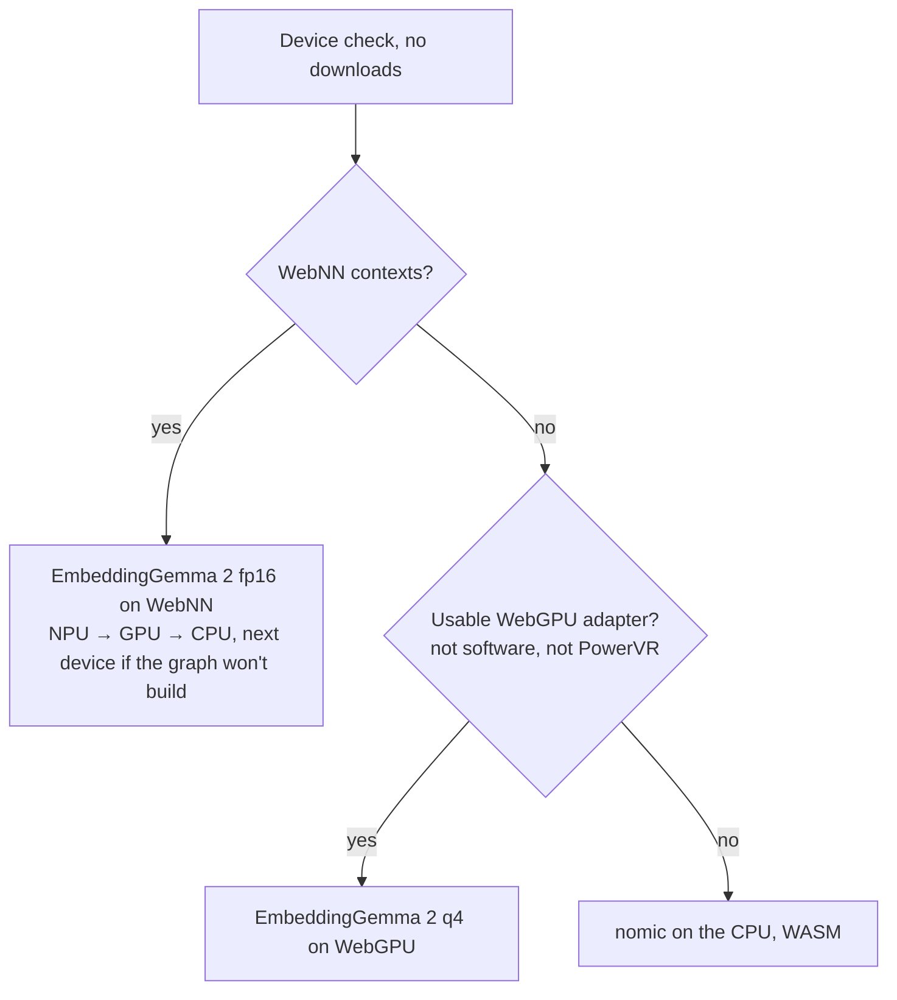

# Media Clusterer 📸 🎥 ✨

A high-performance, **zero-server**, local AI media management tool that runs entirely in your browser. It uses the most native AI hardware the browser offers (**WebNN** on an NPU, GPU or CPU, then **WebGPU**, then plain CPU), with **EmbeddingGemma 2**, **onnxruntime-web**, **Transformers.js** and **DruidJS**.

Try it: <https://barakplasma.github.io/media-clusterer/> · Speed test for your device: [`npu-test.html`](https://barakplasma.github.io/media-clusterer/npu-test.html)

---


---

## 🚀 Key Features

- **Semantic Search**: Find photos and videos by description (e.g., "surfing at sunset", "golden retriever puppy") using multimodal AI.
- **Video Support**: Supports **MP4** and **WEBM** files. Automatically extracts thumbnails for embedding and visualization.
- **Privacy First**: No media is uploaded. No server involved. Everything happens locally on your device.
- **Most native AI path**: WebNN first (NPU → GPU → CPU), then WebGPU, then CPU. A setup wizard checks the device before anything downloads and picks the model most likely to work.
- **Infinite Canvas**: Explore thousands of media files in a fluid, 2D map.
- **Advanced Projections**: Switch between **UMAP**, **t-SNE**, **PCA**, **Isomap**, **LLE**, **MDS**, **Sammon**, and **TriMap** in real-time.
- **Cluster Visualization**: Visually similar media are automatically grouped and colored using k-means clustering.
- **Smart Caching**: Embeddings are cached in IndexedDB for instant re-opening of previously processed folders.

## 🆕 v4.0.0: WebNN first

**Breaking:** the app now prefers WebNN over WebGPU wherever the browser offers it, so EmbeddingGemma 2 runs a different model file (fp16 instead of q4) on those devices. Embeddings cached by v3 on such a device are recomputed once, and the first visit downloads up to 880 MB.

- **WebNN backend for EmbeddingGemma 2** (`src/vlmWebnn.ts`): tries the NPU, then the GPU, then the CPU, moving on when the model does not build on a device. On a Pixel 10 it embeds a photo in about 3 s, where WebGPU on its PowerVR GPU took about 330 s and froze the phone. WebNN is still behind `chrome://flags` → "WebNN API" in Chrome.
- **Setup wizard on first load**: checks WebGPU, WebNN devices, memory and Chrome AI, ranks the models for this device, and waits for a tap before downloading. Return visits load the saved choice straight away.
- **Speed test page** (`npu-test.html`): runs the same model on WebNN NPU / GPU / CPU, WebGPU or WASM and copies a JSON report together with its JSON Schema. Linked from the first-load card and the ⓘ dialog.
- **PowerVR GPUs** (Pixel 10) never run models on WebGPU: EmbeddingGemma 2 uses WebNN, the CPU models use WASM, and the app no longer suggests the unsafe-WebGPU flag there.
- **Fixes**: filtering by year or month from the viewer's date links crashed (Bugsink MEDIA-CLUSTERER-27); a closed "EXIF Data" panel showed behind the toolbar.

### How the AI backend is chosen



## v2.3.0 Features

### Viewer-Only Mode

- **Skip AI processing** - Browse photos instantly without loading embeddings
- Files arranged by **folder structure then date** (matches visual grid layout)
- Enable via settings toggle or use with folders that have thousands of images
- Resume button now works for both viewer and AI modes

### Enhanced Navigation

- **URL state navigation** - Filtered views can be bookmarked and shared
  - `#folder:path/to/folder` - Current folder location
  - `#dt:2025-01-15T14:30` - Datetime filter (year `#dt:2025`, month `#dt:2025-01`, day, hour or minute)
- **Browser back/forward** support for navigation history
- **Clickable breadcrumb navigation** in modal footer:
  - Folder path breadcrumbs with up-one-level arrow (↑)
  - Datetime breadcrumbs (year → month → day → hour → minute)
  - Each breadcrumb click resans the full folder with new filter

### Keyboard Navigation

- **n/p keys** for sequential next/previous through all media in datetime order
- Works consistently in both viewer-only and AI modes

### Enhanced Modal Footer

- Single-row layout showing relative path, filename, datetime, file size, and resolution
- Camera/video metadata display (placeholder for future EXIF support)

## 🛠️ Technology Stack

- **Language**: TypeScript (Strict)
- **AI Engine**: [onnxruntime-web](https://onnxruntime.ai/docs/tutorials/web/) (WebNN, WebGPU, WASM) and [Transformers.js](https://huggingface.co/docs/transformers.js) (v4.3)
- **Default model**: [EmbeddingGemma 2](https://huggingface.co/onnx-community/embeddinggemma-2-ONNX): images, video and text in one 768-d space
- **Build Tool**: [Vite](https://vitejs.dev/) (v8+ with Rolldown)
- **Projections**: [DruidJS](https://github.com/saehm/DruidJS)
- **Deployment**: [Cloudflare Pages](https://pages.cloudflare.com/)

## 📦 Project Structure

```text
index.html          — Main application entry & UI (setup wizard card, dialogs)
npu-test.html       — Speed test / diagnostics page (src/npuTest.ts)
src/
  app.ts            — Core application logic, setup wizard, event handling
  vlmTiers.ts       — Model tiers and backend choice (WebNN / WebGPU overrides)
  vlmWorker.ts      — Inference worker (Transformers.js on WebGPU)
  vlmWebnn.ts       — EmbeddingGemma 2 on WebNN (raw onnxruntime-web sessions)
  modelRanking.ts   — Ranks models for this device from the benchmark
  db.ts             — IndexedDB storage management
  types.ts          — Shared TypeScript interfaces
public/models/      — Graphs this site serves itself (scripts/webnn_split_embed.py)
```

## 👨‍💻 Development

### Setup

```bash
# Install dependencies
npm install

# Start dev server
npm run dev
```

### Tests

```bash
npm test                                # CPU-only end-to-end checks (no GPU needed)
npx playwright test --project=webnn     # EmbeddingGemma 2 on the WebNN path (no GPU needed, 880 MB download)
npm run test:gpu                        # EmbeddingGemma 2 on WebGPU (needs a real GPU)
```

See `AGENT.md` for the full test matrix.

### Build & Deploy

```bash
# Production Build
npm run build

# Deploy to Cloudflare Pages (Manual)
npm run deploy
```

## 🔧 Keyboard Shortcuts

- **Arrow keys / WASD** - Pan around the canvas
- **Mouse wheel** - Zoom in/out
- **n / p** - Next/previous file (in datetime order)
- **r** - Random file
- **Space** - Play/pause the slideshow (asks the order the first time: date, random, or similarity; speed in Settings)
- **Enter** - Open the highlighted file on the map
- **/** - Focus the search box
- **Escape** - Close modal or clear search
- **?** - Show the keyboard shortcut guide
- **`** - Toggle debug overlay

## 📋 Settings

- **Density**: Adjust clustering tightness (lower = tighter, higher = sparse)
- **Loop Videos**: Toggle video looping in modal
- **Theme**: Dark, Light, or System
- **Draw Budget**: Max items to render per frame (performance)
- **Text Search**: Enable/disable semantic search
- **Projection Method**: Choose dimensionality reduction algorithm
- **Batch Size**: GPU inference batch size (higher = faster, more memory)
- **Random Sample Size**: Limit files loaded (0 = all, >0 = random sample)
- **Viewer Only Mode**: Skip AI processing, arrange by folder/date

---

*Built with ❤️ for privacy and high-performance web computing.*
